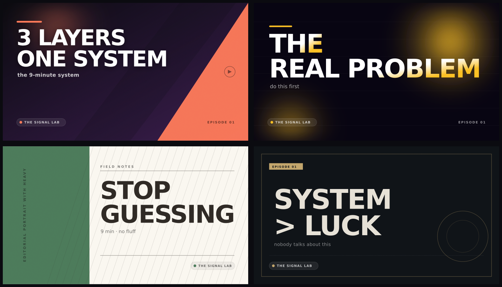

# CreatorPilot Studio

**The AI studio that runs a YouTube channel end to end — and waits for your approval before anything ships.**

CreatorPilot researches a topic, writes the strategy and a spoken-word script, designs a shot list and four real thumbnails, packages the SEO, scores the video against a quality gate, schedules it, and then learns from its own analytics. It runs locally, with your own API keys or with no keys at all.

> Built as a premium, self-hosted alternative to the excellent open-source [youtube-automation-agent](https://github.com/darkzOGx/youtube-automation-agent). The full teardown of that project — what it gets right, where it hurts, and what we changed — is in [ANALYSIS.md](ANALYSIS.md).



*Real output: four vector thumbnail concepts generated for one project, readable at 120 px and downloadable as SVG.*

---

## Why it feels different

| | |
| --- | --- |
| **A real studio, not a CLI wrapper** | Command center, pipeline board, project workspace, calendar, analytics, audience inbox, learning loop. Nine surfaces, one design system. |
| **Seven-stage pipeline** | Research → Strategy → Script → Visuals → SEO → Quality gate → Release, each stage inspectable and individually regenerable. |
| **Human approval is structural** | Nothing publishes without the quality gate passing *and* two explicit attestations (facts, media rights). |
| **Real, usable artifacts** | 1,400-word scripts with beat timing, shot lists, descriptions with chapters, tags, and thumbnails rendered as actual 1280×720 SVG. |
| **Honest by default** | Demo engine is labelled everywhere. Live mode falls back gracefully. Publishing is explicitly a dry run until you wire OAuth. |
| **Local-first** | One JSON file on your disk. No telemetry, no accounts, no cloud. |

## Quick start

```bash
npm install
npm run serve          # builds the UI and starts the studio on :3000
```

Open **http://localhost:3000**. The workspace seeds itself with eight projects across every state, two published videos, real analytics, comments and learning proposals, so every screen is alive on first load.

Development:

```bash
npm run dev            # Vite on :5173, proxying /api to :3000
npm start              # API + built UI on :3000
npm run typecheck
npm run build
```

Requires Node 18+. No database, no native modules, no browser automation.

## The pipeline

| Stage | What the studio produces | Where you see it |
| --- | --- | --- |
| **Research** | Opportunity brief, audience insights, ranked angles with search interest, keyword clusters, competitor patterns, source links | Research tab |
| **Strategy** | Big idea, hook angle, target emotion, differentiators, timed outline, CTA, publish slot | Strategy tab |
| **Script** | Hook, 7–10 narrated beats with word counts and b-roll direction, outro and CTA, runtime at 152 wpm | Script tab, editable inline |
| **Visuals** | Scene-by-scene shot list, palette, compositions, transitions, four thumbnail concepts | Storyboard + Thumbnails |
| **SEO** | Six scored title variants, description with chapters, 16 tags, hashtags, CTR prediction, score breakdown | SEO tab |
| **Quality gate** | Eight automated checks, blockers, two human attestations | Quality gate |
| **Release** | Publish slot, privacy, pre-flight checklist, export package | Publish tab |

Every stage is checkpointed. Regenerating a stage invalidates everything downstream instead of silently mixing artifacts.

### Quality gate

Automated checks run against the actual artifacts — not vibes:

- Research evidence attached · runtime vs promise · opening-line length · beat completeness · visual plan · title length · thumbnail palette contrast · metadata completeness · explicit fact-review flag · CTA.

Warnings are advisory; failures are blockers. Approval is impossible while a blocker exists, and the two attestations (facts reviewed, rights cleared) are required before the Approve button unlocks.

### Live or demo

- **Demo engine (default)** — a deterministic local content engine. Every screen is fully functional; narration is explicitly labelled illustrative rather than researched.
- **Live mode** — add an OpenAI, Gemini, OpenRouter, DeepSeek or Anthropic key in **Settings → AI providers**, enable it, then flip the engine switch. Research, strategy, script and SEO call the model with strict JSON prompts and schema validation. Any failure falls back to the demo engine, so the pipeline never strands.

Keys live only in `data/store.json` on your machine.

## Thumbnails without an image model

The art director emits four concepts — `bold`, `glow`, `editorial`, `minimal` — and the server renders each as a real SVG at 1280×720 with measured type layout, safe margins, palette-aware contrast and channel branding. Download the SVG or copy the concept as a prompt for your own generator.

## Analytics and learning

- 60 days of channel history, per-video daily series, CTR, AVD, watch hours, subscribers and estimated revenue.
- Audience-retention curve mapped onto scene boundaries, with per-scene drop analysis.
- A learning loop that only proposes moves backed by your own baseline, with approve/reject gates.
- Title A/B experiments with impression splits and a 95% confidence threshold before a winner can be adopted.
- An audience inbox that triages sentiment, themes and spam, drafts replies in your voice, and posts only after your approval.

## API

All routes are local and JSON. Highlights:

```
GET    /api/dashboard            KPIs, series, pipeline, activity
GET    /api/projects             list + counts
POST   /api/projects             create (optionally auto-run the pipeline)
GET    /api/projects/:id         project, active job, comments, cost estimate
PATCH  /api/projects/:id         title, description, beats, thumbnail
POST   /api/projects/:id/run     run/resume the pipeline
POST   /api/projects/:id/stage/:stage/regenerate
POST   /api/projects/:id/approve | reject | schedule | publish-now | duplicate
GET    /api/projects/:id/export  Markdown production package
GET    /api/projects/:id/thumbnail/:tid.svg
GET    /api/analytics            series, totals, per-video metrics
GET    /api/comments?filter=     audience inbox
POST   /api/comments/:id/draft | reply | quarantine
GET    /api/recommendations      learning loop + experiments
POST   /api/autopilot/run        plan and generate N episodes
PUT    /api/settings             channel, brand, providers, automation
GET    /api/events               server-sent events for live progress
```

## Architecture

```
server/
  index.ts              Express API, 30+ routes, SSE, dry-run publish queue
  pipeline.ts           seven-stage runner, job log, stage invalidation
  content-engine.ts     deterministic research/strategy/script/SEO + quality checks
  ai.ts                 OpenAI-compatible, Gemini and Anthropic adapters
  thumbnails.ts         SVG art director (measured layout, four variants)
  analytics-engine.ts   metrics, retention curves, recommendations, experiments
  store.ts / seed.ts    atomic JSON persistence and demo dataset
shared/types.ts         the contract between server and UI
src/
  components/           shell, command palette, charts, design-system primitives
  pages/                dashboard, pipeline, workspace, analytics, audience,
                        insights, calendar, autopilot, settings
```

## What is intentionally not faked

- **Publishing is a dry run.** The project is marked published and analytics are generated, but nothing is uploaded. The governed OAuth/upload path is the next integration (see roadmap).
- **Narration audio is not synthesised.** The script is narration-ready with timing; TTS is not wired in this build.
- **Demo content is not researched.** It is labelled as such on the project, in the quality gate and in the activity log.

## Roadmap

1. YouTube Data API OAuth: real upload, thumbnails, playlists, scheduling. 
2. TTS providers (ElevenLabs, OpenAI, Gemini) with per-scene audio and a rebuild step.
3. Image generation for scenes, with the vector thumbnail as the fallback.
4. Multi-channel workspaces and a team review queue.
5. Optional Postgres adapter for multi-user deployments.

## License

MIT. Built for legitimate content creation — follow YouTube's Terms of Service and Community Guidelines.
